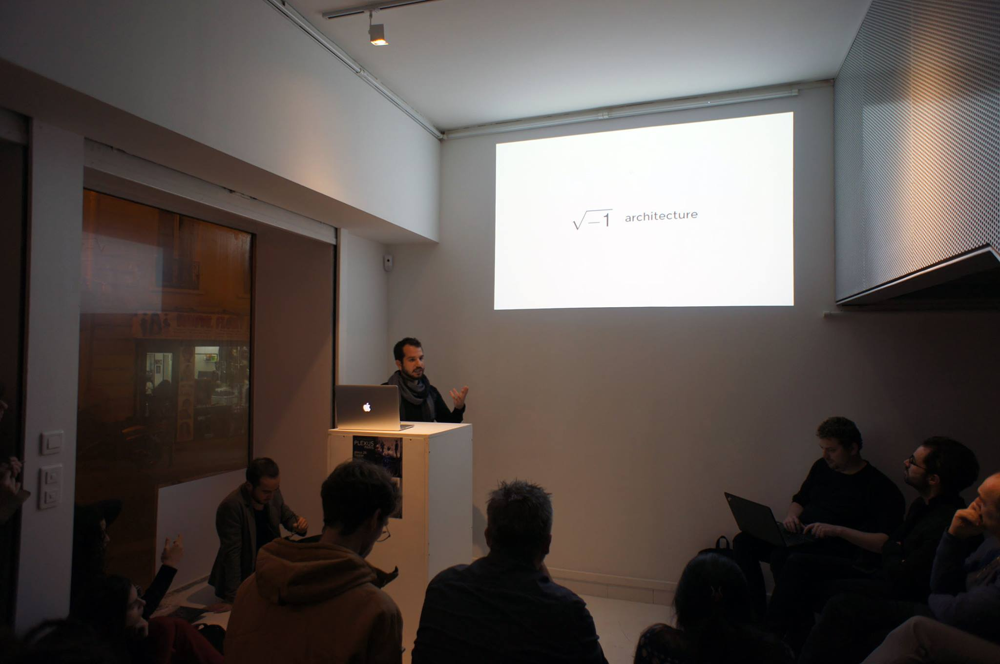

Event organized by Pierre Cutellic in collaboration with AA n+1.  
AA n+1 gallery, Paris, November 16, 2016

**Description**  
The Plexus Project is an initiative to bring together the creative talent of different disciplines to share techniques, solve problems and build networks of collaboration. The events take place every month inviting young designers, architects, engineers, programmers, game designers and visual artists. This initiative is open to anyone in London that is looking for an informal place to network and learn about new methodologies and workflows.  
The event was initially called Bartlett Nexus and was created by Jose Sanchez, currently he co-curates it together with Manuel Jimenez Garcia, who joined the event organization in September of 2013.

**Speakers**
- Prof. Frederic Migayrou (UCL),
- Manuel Jimenez Garcia (UCL), 
- Constantinos Miltiadis (TU Graz), and
- Corneel Cannaerts (KU Leuven). 

